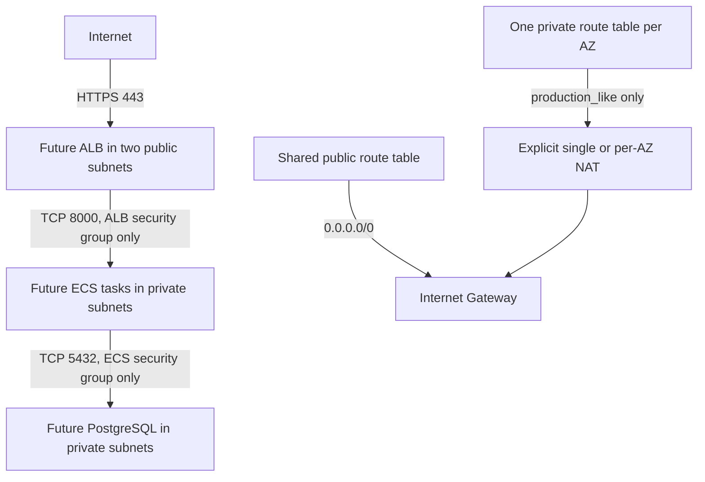

# Terraform AWS networking foundation

This configuration describes the network only. It does not define an ALB, ECS
service, PostgreSQL/RDS instance, IAM credentials, or CI/CD. Validation does not
create resources. No apply or destroy is part of this milestone.

## Architecture

Region: **ap-south-1 (Mumbai)**. VPC: **10.0.0.0/16**.

| Availability zone | Public subnet | Private subnet |
| --- | --- | --- |
| ap-south-1a | 10.0.0.0/24 | 10.0.10.0/24 |
| ap-south-1b | 10.0.1.0/24 | 10.0.11.0/24 |

The dev root uses explicit AZ names, so init and validation need no AWS API calls.
Confirm these AZs are available in the target account before a future deployment.
AZ names can map to different physical zones in different accounts. Preserve the
input AZ order: changing it changes subnet CIDR assignments and can replace subnets.



A **VPC** is an isolated IP network. **Subnets** divide its address space and each
belongs to one availability zone. Two AZs provide placement options for future
resilient services; creating subnets alone does not make an application highly available.

A **route table** selects the next hop for traffic. Both public subnets share an
Internet Gateway default route. Each private subnet has its own route table with
the automatic VPC-local route. In cost_saver there is no private default route.
Public routing does not itself give a workload a public IP: automatic public IPv4
assignment is disabled on all subnets. A future internet-facing ALB manages its own
addresses; ECS tasks should use private subnets without public IPs.

## Network modes and cost

| network_mode | nat_gateway_mode | NAT/EIP count | Private outbound access |
| --- | --- | --- | --- |
| cost_saver (default) | none (default) | 0 / 0 | VPC-local only |
| production_like | single (explicit) | 1 / 1 | Both AZs use NAT in first AZ |
| production_like | per_az (explicit) | 2 / 2 | Each AZ uses its own NAT |

The module rejects NAT in cost_saver and rejects production_like without an explicit
single/per_az selection. Changing only `network_mode` cannot silently enable NAT.
Switching an existing deployment back to cost_saver would remove NAT resources and
outbound access during a future apply; review that impact before any deployment.

**NAT gateways are billable even while idle.** Costs include gateway-hours, GB
processed, public IPv4 addresses, and potentially internet/cross-AZ data transfer.
For a 730-hour planning month, the fixed component is approximately
`gateway_count × 730 × (Mumbai NAT hourly rate + public IPv4 hourly rate)`.
Add data processing and applicable transfer charges. Check current Mumbai rates
in [AWS VPC pricing](https://aws.amazon.com/vpc/pricing/) and the
[AWS Pricing Calculator](https://calculator.aws/) before opting in; this is a cost
formula, not a price quote. AWS documents hourly and per-GB charges in its
[NAT pricing guidance](https://docs.aws.amazon.com/vpc/latest/userguide/nat-gateway-pricing.html).

Single NAT has a lower fixed cost but creates an AZ dependency and can incur
cross-AZ charges. Per-AZ NAT improves outbound fault isolation at twice the gateway
and IPv4 count. No NAT/EIP is configured by default; this does not promise that a
future complete application deployment will be free.

In cost_saver, private ECS tasks cannot pull public images or reach public ECR,
CloudWatch Logs, or Secrets Manager APIs without additional connectivity. Before
deploying tasks, deliberately choose NAT or suitable VPC endpoints (for ECR this
typically includes ECR API/DKR interface endpoints plus an S3 gateway endpoint).
Interface endpoints have their own hourly/data costs. No endpoints are added here.
The private PostgreSQL and ECS subnets remain mutually routable via the VPC-local
route in both modes. A future database-only tier can use separate isolated route
tables; in this two-private-subnet design NAT routes are shared by that tier.

## Security groups

Security groups are stateful firewalls attached to future network interfaces.
They do not attach directly to a subnet and they do not grant IAM permissions.

| Group | Ingress | Egress |
| --- | --- | --- |
| ALB | TCP 443 from alb_ingress_cidrs (default 0.0.0.0/0) | TCP 8000 to ECS group |
| ECS | TCP 8000 from ALB group only | TCP 5432 to PostgreSQL group; TCP 443 to IPv4 destinations |
| PostgreSQL | TCP 5432 from ECS group only | No new outbound connections |
| VPC default | None | None |

Security group references restrict the allowed source to interfaces carrying the
referenced group, rather than trusting every IP in the VPC. Responses to permitted
connections are automatically allowed; PostgreSQL needs no broad egress rule to
reply. The ECS HTTPS permission does not create a route: cost_saver still has no
internet egress. Future endpoint rules can narrow that permission further.
The VPC's Amazon-provided DNS resolver is not filtered by security group rules.
There is no SSH access, public PostgreSQL access, or IPv6 configuration.
The future ALB requires an HTTPS listener and certificate, which are outside this
milestone. Default network ACLs are retained; security groups provide tier filtering.

## Terraform files

| File | Responsibility |
| --- | --- |
| infra/modules/network/versions.tf | Terraform >=1.9,<2 and AWS provider 6.x constraints |
| infra/modules/network/variables.tf | Module inputs, CIDR/AZ validation, and NAT opt-in guardrails |
| infra/modules/network/main.tf | Tags, CIDR allocation, VPC, four subnets, Internet Gateway, routes and associations |
| infra/modules/network/nat.tf | Conditional EIPs, NAT gateways, and private default routes |
| infra/modules/network/security_groups.tf | Three future service groups, explicit rules, and deny-all default group |
| infra/modules/network/outputs.tf | VPC/CIDR, subnet IDs, security group IDs, private route table IDs, NAT IDs |
| infra/modules/network/tests/network.tftest.hcl | Mock-provider plan tests for topology and NAT guardrails; no AWS calls |
| infra/modules/network/.terraform.lock.hcl | Matching provider lock for standalone module validation/tests |
| infra/envs/dev/versions.tf | Root Terraform/provider version requirements |
| infra/envs/dev/providers.tf | AWS region ap-south-1 and default project/environment/ownership tags |
| infra/envs/dev/variables.tf | Dev overrides and Mumbai AZ-name validation |
| infra/envs/dev/main.tf | Instantiates the network module with VPC 10.0.0.0/16 |
| infra/envs/dev/outputs.tf | Exposes IDs for future service modules |
| infra/envs/dev/terraform.tfvars.example | Safe, nonsecret cost_saver example and commented NAT opt-in |
| infra/envs/dev/.terraform.lock.hcl | Exact provider version and checksums selected by init; keep in Git |

Resources support Project, Environment, ManagedBy, NetworkMode and descriptive
Name tags where AWS supports tagging. Subnets also have Tier tags. Extra tags can
carry ownership/cost-center values; module-owned tags take precedence. Route and
association resources have no AWS tags of their own.

## Validation only

Use Terraform >=1.9,<2. Run from the repository root:

```powershell
terraform fmt -recursive
terraform fmt -recursive -check
terraform -chdir=infra/envs/dev init -backend=false
terraform -chdir=infra/envs/dev validate
terraform -chdir=infra/modules/network init -backend=false
terraform -chdir=infra/modules/network validate
terraform -chdir=infra/modules/network test
```

The tests all specify `command = plan` with a mock AWS provider, so they do not
perform apply operations or contact AWS. Init downloads providers from HashiCorp;
it does not provision AWS infrastructure. No backend infrastructure is configured.
State would be local in a future deployment until a separate backend design is
implemented. Keep `.terraform/`, state and local tfvars out of Git; commit lockfiles.

If using this workspace's portable tool, replace `terraform` with
`.\.tools\terraform\terraform.exe`. It is stored locally, ignored by Git, and was
downloaded from [HashiCorp releases](https://releases.hashicorp.com/terraform/1.13.5/)
with its published SHA-256 checksum verified.

No credentials are needed for these checks. For a separately authorized future
AWS plan, use the normal AWS credential chain such as AWS IAM Identity Center/SSO
or an assumed role. Do not create or place IAM access keys in Terraform files.
Validation checks syntax and provider schemas, not account quotas, AZ availability,
actual routing, deployed security boundaries, or final AWS cost.

See [actual verification results](../evidence/network-foundation-verification.md)
for tool versions, passed checks, and remaining validation boundaries.
