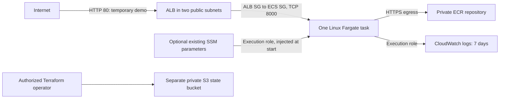

# ECS Fargate demo infrastructure — implementation only

See [actual validation results and changed-file inventory](../evidence/ecs-infrastructure-verification.md).

No infrastructure, credentials, container images, ECS tasks or Terraform state have
been deployed or migrated as part of this milestone. The existing Dockerfile,
Compose PostgreSQL setup, application and Python tests remain unchanged.

## Architecture



The network remains `10.0.0.0/16` in `ap-southeast-2`, with public `10.0.0.0/24` and
`10.0.1.0/24`, and private `10.0.10.0/24` and `10.0.11.0/24`. With
`availability_zones=[]`, the dev root discovers and selects the first two sorted
available standard AZs in Sydney; it does not assume specific AZ suffixes. An
explicit two-zone override preserves its order. Pin the selected pair after first
deployment if availability changes could otherwise alter placement.

**cost_saver:** ECS uses existing public subnets with `assign_public_ip=true`.
Public IPs plus the Internet Gateway route provide HTTPS access to ECR, S3 image
layers, Logs and SSM. Only the ALB security group can enter the task on TCP 8000;
a public IP is not permission for direct inbound access. The network module still
disables automatic public IP assignment on subnets; ECS explicitly requests it
for each task ENI. No NAT gateway or EIP is created. Public IPv4 addresses are billable.

**production_like:** ECS uses private subnets without public IPs. The preserved
network module requires explicit `nat_gateway_mode=single` or `per_az`. These modes
create one or two billable NAT gateways/EIPs. The service waits for network routes
before it starts. A future endpoint-only alternative needs deliberate module changes
and endpoint policies/security groups for ECR API/DKR, S3, Logs and SSM as used;
private subnets alone do not provide access. Endpoint-only production networking is
not implemented or silently assumed here.

## Module dependency and file guide

Each implemented module has `versions.tf`, `variables.tf`, `main.tf` and `outputs.tf`:
version/provider constraints, validated inputs, resources, and the IDs consumed by
other modules. Provider configuration remains in the environment root.

| Location | Resources and relationships |
| --- | --- |
| `infra/bootstrap/` | Independent local-state root creates the S3 backend bucket, versioning, encryption, ownership/public-access controls and HTTPS policy. See its README. |
| `infra/modules/network/` | Existing VPC/subnets/routes/NAT guardrails preserved. Adds `alb_ingress_port` with default 443; dev explicitly selects 80. The existing `alb_https` rule address is retained to avoid address churn. |
| `infra/modules/ecr/` | Immutable private repository, AES256 encryption, basic scan-on-push, lifecycle retaining the most recent 20 images; exports repository URL/ARN. |
| `infra/modules/observability/` | Pre-created `/ecs/<project>-<environment>` log group, seven-day retention; exports name/ARN. No advanced monitoring. |
| `infra/modules/iam/` | Separate execution and application roles, ECS-only trust restricted to current account. Depends on ECR and Logs ARNs. |
| `infra/modules/alb/` | Public ALB, HTTP:80 listener, IP target group on HTTP:8000, `/ready` probe. Depends on network outputs; target-group output waits for listener creation. |
| `infra/modules/ecs_service/` | Cluster, Linux/X86_64 task definition, Fargate service; consumes network, ALB, IAM, ECR and log outputs. |
| `infra/envs/dev/main.tf` | Wires five managed modules and the read-only ECR lookup; ECS additionally depends on network completion. |
| `infra/envs/dev/providers.tf` | Region and default tags, without credentials. |
| `infra/envs/dev/versions.tf` | Partial S3 backend with encryption and native locking; Terraform >=1.10 and AWS provider 6.x. |
| `infra/envs/dev/variables.tf` | Image, region/environment, task count, modes, version metadata and optional SSM ARN inputs. Rejects RDS enablement. |
| `infra/envs/dev/outputs.tf` | Network IDs, ECR URL, ALB DNS/demo URL, ECS names and log group. |
| `infra/envs/dev/backend.hcl.example` | Nonsecret backend template; copy to ignored `backend.hcl` only for future authorized initialization. |
| `infra/envs/dev/terraform.tfvars.example` | Explicit example configuration with image placeholders; replace placeholders before a real plan. |
| `infra/envs/dev/tests/` | Mock plans of individual modules and full dev graph, including invalid-input tests. |

The `rds`, `github_oidc`, and `budgets` directories remain placeholders. There is
no additional nested project/repository. Backend buckets are not dependencies in
the dev graph: Terraform must initialize the backend before evaluating modules.

## Runtime and database behavior

The task uses 256 CPU units, 512 MiB memory, port 8000, and the image's existing
exec-form Uvicorn command binding to `0.0.0.0`. The runtime UID/GID is 10001:10001.
Build the image for `linux/amd64` to match `X86_64`. No local source/secret mounts,
Compose `depends_on`, or Compose hostname `db` are copied to ECS.

`DATABASE_URL` and `DATABASE_PASSWORD_FILE` are empty in ECS. The existing FastAPI
logic treats the empty URL as unconfigured, so `/ready` returns ready without a DB
connection. `/health` remains the container liveness check. ALB `/ready` requires
HTTP 200, checks every 30 seconds, times out after five seconds, and uses two healthy
or three unhealthy results. ECS gives new tasks 60 seconds of health-check grace.

The service initially requests one task and enables deployment circuit-breaker
rollback. Rolling updates may run two tasks temporarily (100% minimum healthy,
200% maximum). Rollback requires a previously completed deployment; the very first
deployment has no known-good revision to return to. One task is not highly available
despite the two-AZ subnet layout. `wait_for_steady_state=true` makes a future deployment
wait for readiness rather than reporting success immediately.

`enable_rds` is reserved and must stay false. Database variables cannot be overridden
through SSM in this milestone. Future RDS requires its own provisioning, credentials,
connectivity, TLS and readiness tests without changing local Compose behavior.

## IAM and optional SSM

The execution role can get an ECR token, pull from this repository only, and create
streams/write events under this log group only. `ecr:GetAuthorizationToken` requires
`Resource="*"`; repository pull actions are scoped. The log-stream wildcard is bounded
by the designated group. There are no administrator policies or permanent access keys.
The FastAPI application calls no AWS APIs, so its separate task role has no permissions.

SSM injection is disabled by default. To opt in later, supply
`enable_ssm_parameters=true` and a map of environment names to **existing parameter ARNs**.
Do not supply values or put secrets in Terraform variables. The execution policy grants
`ssm:GetParameters` only for those ARNs. Optional customer-managed KMS keys must be listed
explicitly; decrypt is constrained through SSM and the parameter encryption context.
AWS-managed SSM key use normally needs no additional custom key policy here.
Parameter creation/secret value management is intentionally outside Terraform in this
milestone, avoiding secret values in state. The app currently consumes no extra custom
secret variables; these are optional infrastructure hooks, not new application features.
Changing a parameter value does not restart existing tasks: a later authorized new
deployment is needed to inject updated values. ECS Exec is disabled.

## Validation (safe, no AWS deployment)

```powershell
terraform fmt -recursive
terraform fmt -check -recursive
terraform -chdir=infra/bootstrap init -backend=false
terraform -chdir=infra/bootstrap validate
terraform -chdir=infra/bootstrap test
terraform -chdir=infra/envs/dev init -backend=false
terraform -chdir=infra/envs/dev validate
terraform -chdir=infra/envs/dev test
terraform -chdir=infra/modules/network init -backend=false
terraform -chdir=infra/modules/network validate
terraform -chdir=infra/modules/network test
```

Use Terraform 1.17.1 for the provided mock tests. All test runs use `command=plan`
with a mock AWS provider, including the full dev graph. Fixture account numbers and
ARNs are synthetic test data; no real account IDs are hardcoded into configuration.
Tests do not initialize the real S3 backend or call AWS. Dev validation also checks
all referenced child modules; other module tests run through the dev test root.
Keep provider lockfiles in Git; ignored `.terraform/` contains local caches only.

## Before the first AWS deployment

1. Review the account, Sydney AZ availability, quotas, intended access roles, budget
   and the complete Terraform plan with the owner. Obtain separate deployment approval.
2. Choose a unique state bucket name. Follow `infra/bootstrap/README.md` to bootstrap
   local state and prepare remote dev initialization. Never migrate state implicitly.
3. Set actual Sydney `container_image`, region/AZs, environment, APP_VERSION/GIT_SHA and trusted
   ALB client CIDRs. `container_image` must belong to the separately managed ECR repository and
   use a release tag or digest, never `latest`. No arbitrary public image fallback exists.
   Backend bucket region, ECR URI, and any optional SSM/KMS ARNs must reference the
   intended locations; examples now use `ap-southeast-2`. There are no EC2 AMI IDs:
   this uses Linux/X86_64 Fargate. IAM ECS/KMS service ARNs are derived from the active
   provider's region and partition. A region configuration edit is not a state or
   resource migration, and does not establish Free plan eligibility or pricing.
4. ECR is owned by `infra/envs/ecr` under its own S3 state key. Deploy that root
   only after reviewing and approving its plan. Dev reads the repository through
   `data.aws_ecr_repository.app`; setting `desired_count=0` does not create ECR.
   Separately approve/build/scan/push the linux/amd64 image, then review the complete
   dev plan. Even with zero tasks, deployed ALB resources remain billable.
5. Verify the image exists and any opted-in SSM parameters/key permissions are correct
   before enabling tasks. No image push or AWS credential setup is performed by this code.
6. After a separately approved deployment, verify ALB target health, `/health`, `/ready`,
   `/version`, `/metrics`, logs, and a controlled failed-deployment rollback. Confirm
   direct access to task public IP port 8000 is blocked. These live checks remain unrun.

## Risks, limits and costs

- **HTTP is temporary demo-only.** Do not send credentials, real user data, or sensitive
  traffic through it. Add ACM/TLS and an HTTPS listener before production; the
  `production_like` network setting alone does not make this demo production-ready.
- Default ALB ingress is public. Restrict `alb_ingress_cidrs` to your test IP/CIDR
  when practical. API docs, metrics and version endpoints currently share the listener.
- A public task IP is an explicit cost_saver tradeoff. Inbound isolation depends on
  attaching only the intended ECS SG and preserving its rules.
- ECR keeps only 20 images; very old deployed/rollback revisions can be expired.
  Review retention against deployment frequency before production.
- Fargate CPU/memory and runtime, ALB hours/LCUs, public IPv4 addresses and data transfer
  are billable. Budget for one steady-state task and temporarily two during deployment.
- ECR image storage, CloudWatch ingestion/storage (7 days), and S3 state versions/requests
  can incur charges. Optional advanced SSM/high throughput or customer-managed KMS keys
  add charges. Standard parameters at standard throughput have no added Parameter Store fee.
- Explicit production_like NAT incurs one/two gateway-hour, EIP and data-processing
  charges. Future interface endpoints also have per-AZ hourly/data charges. No NAT, RDS,
  DynamoDB lock table, advanced monitoring or customer-managed KMS key is created by default.
- Cost_saver is lower-resource, not free. Obtain a regional estimate for the chosen
  task hours, traffic, image size, log volume and connectivity before deployment.

References: [S3 locking](https://developer.hashicorp.com/terraform/language/backend/s3),
[ECS execution role](https://docs.aws.amazon.com/AmazonECS/latest/developerguide/task_execution_IAM_role.html),
[ECR private connectivity](https://docs.aws.amazon.com/AmazonECR/latest/userguide/vpc-endpoints.html),
[Fargate pricing](https://aws.amazon.com/fargate/pricing/),
[ALB pricing](https://aws.amazon.com/elasticloadbalancing/pricing/),
[VPC pricing](https://aws.amazon.com/vpc/pricing/).
